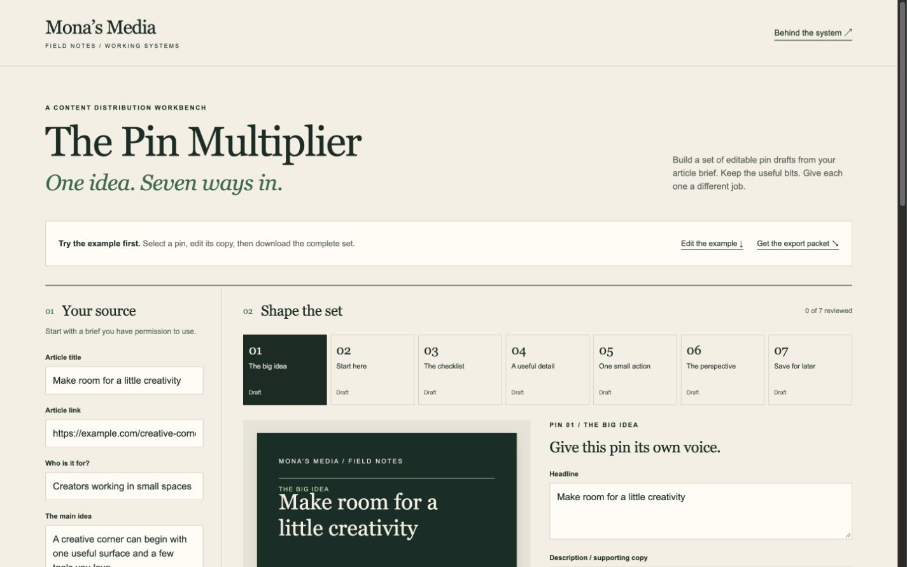

# The Pin Multiplier

An original Mona’s Media workbench for turning one article brief into seven editable pin concepts.

**[Try the live workbench →](https://monaleafah.github.io/pin-multiplier/)** · [Read the case study](https://monaleafah.github.io/pin-multiplier/case-study.html) · [Starter guide](starter-guide.md)

## Your first set

1. Try the fictional example, or enter an article brief you have permission to use.
2. Select an angle, refine its headline and supporting copy, and review the alt text.
3. Review the seven graphics together. Download the complete packet when the set is ready.

The ZIP contains seven PNGs, seven editable SVGs, a CSV, a reopenable JSON plan, a blank results tracker, and instructions. Draft states remain visible in the plan.

Open `index.html` directly in a modern browser. There is no installation, account, API key, or build step. For a local server, run `npm start` and visit `http://127.0.0.1:4173/`.

## What works

- Seven editorial angles using a supplied title, main idea, and useful points.
- Editable headlines, supporting copy, alt text, and plan dates.
- A per-pin human review state. Editing content returns the pin to Draft.
- A relationship disclosure field when an affiliate or paid relationship is selected.
- PNG and SVG exports at 1000 × 1500 pixels, individually or in one complete ZIP.
- Visual overview of all seven graphics; source-specific starting headlines.
- Undo for the last plan replacement and export protection for unapplied source changes.
- Unfinished JSON save/reopen; incomplete graphics cannot export.
- Blank trial tracker for actual results, with no invented performance data.
- CSV exports with spreadsheet formula protection.
- JSON save and reopen, with validation and renewed human review.
- Responsive interface, labeled controls, keyboard focus, and reduced-motion support.

## The example

The creative-corner article and `example.com` destination are fictional. The demo demonstrates workflow output; it makes no claims about traffic, revenue, conversions, or time savings.

## Privacy and boundaries

The application generates drafts locally with deterministic templates. It does not fetch the article, call an AI service, use analytics, store work in local storage, or publish pins. Save JSON before reloading or closing. The planned cadence is editable and is not a platform recommendation. A disclosure field helps document review; it does not establish legal or platform compliance.

The source is independently authored for this demo. It contains no employer code, product assets, customer data, or private repository history. Mona’s Media branding identifies the author; the code license does not grant trademark rights.

## Verification

`npm test` runs Node’s built-in tests; no dependencies are required. `npm run export:sample` writes seven SVGs plus JSON and CSV to `sample-export/`. See `TESTING.md` for observed browser validation and practical limits.

## License

The demo code and fictional sample are MIT licensed. The license permits use, modification, distribution, and commercial reuse with the required notice. Consulting services, future products, and third-party materials have their own terms.

## Mona’s Media

[Portfolio](https://monasmedia.com/thework/) · [Field Notes and consultations](https://monasmedia.com/thefieldnotes/)
